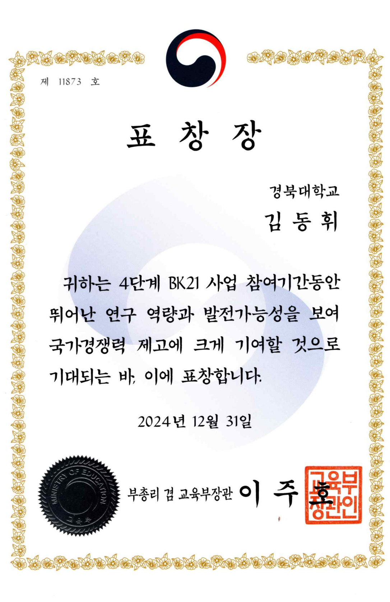
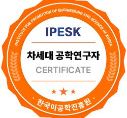
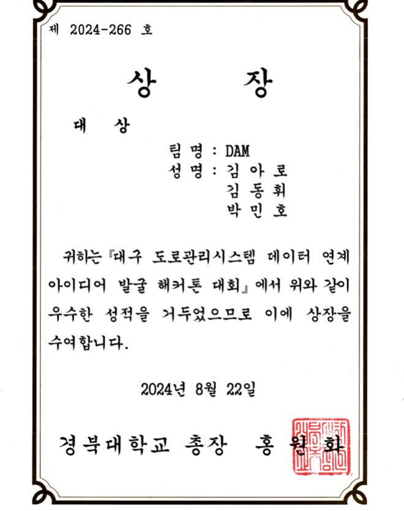
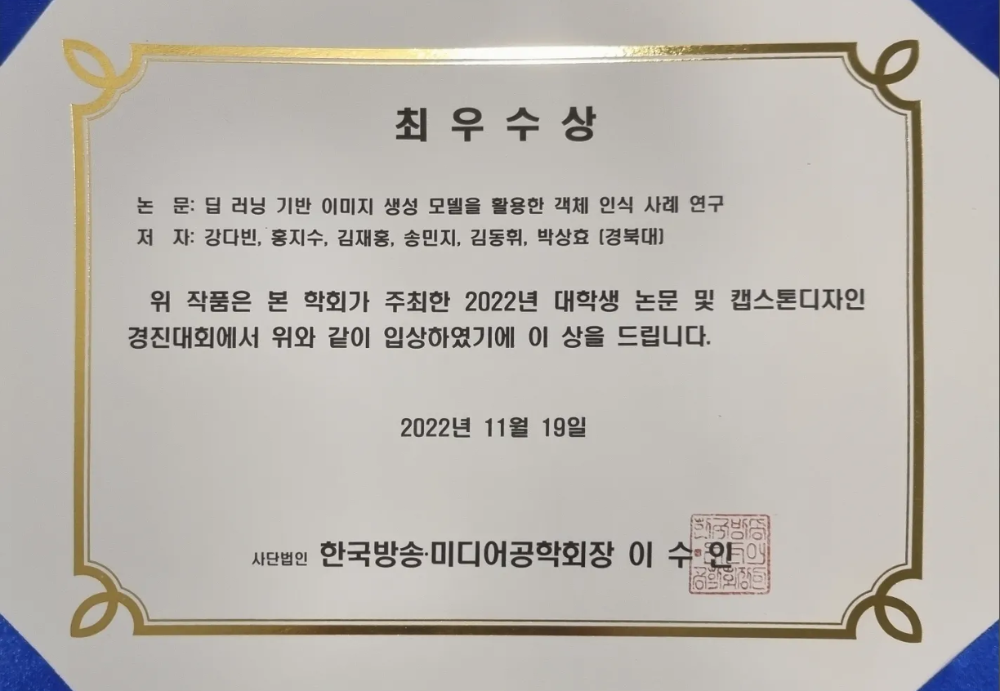

## Dong-hwi Kim

PhD candidate · School of Computer Science and Engineering · Kyungpook National University  
[dhwi@knu.ac.kr](mailto:dhwi@knu.ac.kr) · [Google Scholar](https://scholar.google.co.kr/citations?hl=en&user=kAeQFX4AAAAJ) · [GitHub](https://github.com/dhwi96) · [LinkedIn](https://www.linkedin.com/in/dhwi96/)

## Education

- **Ph.D. candidate**, Kyungpook National University, March 2023–present  
  School of Computer Science and Engineering · Advisor: Prof. Sang-hyo Park
- **M.S.**, Kyungpook National University, March 2021–February 2023  
  School of Computer Science and Engineering · Advisor: Prof. Sang-hyo Park

## Research interests

Image processing (video compression, super-resolution, denoising, restoration); 2D/3D vision
(novel-view synthesis, multi-view stereo, spatial AI); generative AI (diffusion models, GANs).

## Professional experience and service

- **ISO/IEC JTC 1/SC 29 (MPEG)**, July 2023–present: WG 3 (Systems), WG 4 (Video Coding), WG 5 (JVET), WG 7 (3D Graphics and Haptics)
- **TTA 신진 표준화 전문가**, April 2024–present
- **Reviewer**, ACM Multimedia (MM), 2026–present

## Project experience

| Period          | Sponsor | Project                                                                          |
| :-------------- | :------ | :------------------------------------------------------------------------------- |
| 2025.03–present | NRF     | 다재다능한 멀티모달 AI를 위한 3D Gaussian Splatting의 표현 및 압축 원천기술 연구 |
| 2023.04–2025.12 | IITP    | 3차원 공간 디지털미디어 규격화 기술 개발                                         |
| 2022.07–2024.12 | IITP    | 이동형 로봇 기반 실사 메타버스 실감형 비디오의 획득 및 처리 기술 개발            |
| 2023.02–2024.05 | NRF     | 다목적 비디오 부호화를 위한 초경량화 신경망 연구                                 |
| 2023.08–2023.11 | KETI    | 3차원 자세 추정 모델 경량화 및 최적화 SW 개발                                    |
| 2022.04–2022.12 | IITP    | 재난정보인지 취약계층을 위한 맞춤형 재난미디어 서비스 플랫폼 기술 개발           |
| 2022.02–2022.03 | ETRI    | 머신비전 특성을 고려한 VTM기반 부호화 도구 구현                                  |
| 2022.01–2022.12 | IITP    | 객체 가로 비율을 고려한 화면비 변환 기술 연구                                    |

## Teaching

See [teaching experience](/teaching/) for courses and training.

## Awards and honors

### 교육부장관 표창 · December 2024

4단계 BK21 사업 우수 참여인력 표창

### IPSEK 차세대 공학연구자 · December 2024

(사) 한국이공학진흥원

### 대상 (경북대학교 총장상) · August 2024

대구 도로관리시스템 데이터 연계 아이디어 발굴 해커톤 대회 · [Announcement](https://cse.knu.ac.kr/bbs/board.php?bo_table=sub5_2_a&wr_id=549)

### 최우수상 · November 2022

한국방송·미디어공학회 추계학술대회 대학생 논문대회 · [Announcement](https://cse.knu.ac.kr/bbs/board.php?bo_table=sub5_2_a&wr_id=489)

## Publications

See the complete [publication list](/publications/).
